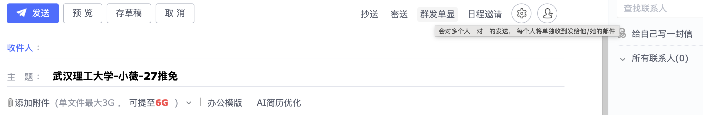
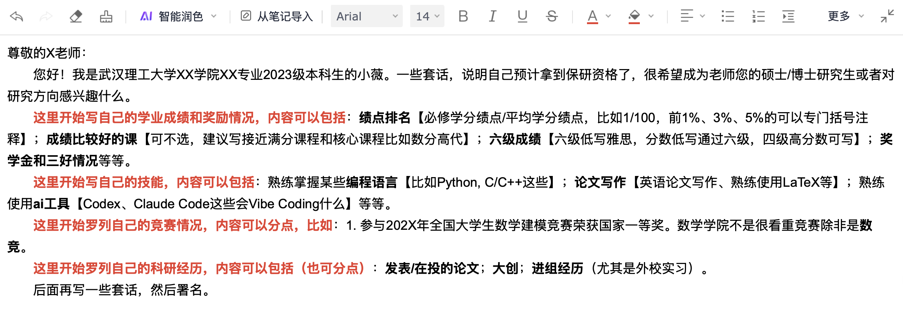

# 套磁
套磁一直是保研中极为重要的一环，需要尽早开始。但是不清楚保研提前和今年鸽子满天飞情况会不会让很多老师不愿意提前给机会（不过**直博**请务必提前套磁）。
## 发套磁信

首先，建议使用网易邮箱，手机号注册即可。

- 格式一般是这样：

    

    添加的附件至少应该包括你的**简历**。

- 内容可参考：

    

    这里的外校实习是指：暑研、RA这些，有成果最好！

    建议在xhs上搜一些模板，并让AI进行加工，不要同质化。如果有时间，可以了解下意向老师的研究方向（具体让AI帮你总结并修改邮件内容，比如展示自己在这个领域的高分核心课程、相关科研经历等）。

- 右下角可以**邮件追踪**，但是有一定概率老师会不快。**千万不要附件追踪**，否则必须下载文件才能看简历（无法预览）。

## 回复情况

老师一般会回复：

- “欢迎报考”“欢迎报名预推免”等客套话。表明老师多半对你不感兴趣，大概率是群发。
- “可以聊聊”或者直接发一个腾讯会议号/电话号码。表明老师愿意给你机会，需要进行面试（建议准备PPT，部分简短简历面）。线上面试专业问题一般围绕**简历**（要仔细打磨并熟悉）。可以争取加下wx，不给也没关系。
- 不回复。这是最常见的情况，但不代表没机会，保研后期可以再发（因为老师可能被鸽了，有名额也说不准）。

## Tips

1. 记录联系过的导师（如列表）。可以按学校分类，否则容易忘记，一个老师重复发，给人印象也不好。
2. 群发单显功能谨慎考虑使用。因为如果老师的研究方向类似，即使不是一个学校仍然有可能在一个圈子里，一个学校同专业的老师就更别同时套磁了。
3. 加了wx后一定要保持联系（节日可以祝福一下），puq别点赞（同个圈子可能互相有wx）。
4. 发了2-3天不回或者追踪功能看到已读不回1天以上，就可以找下家了。
